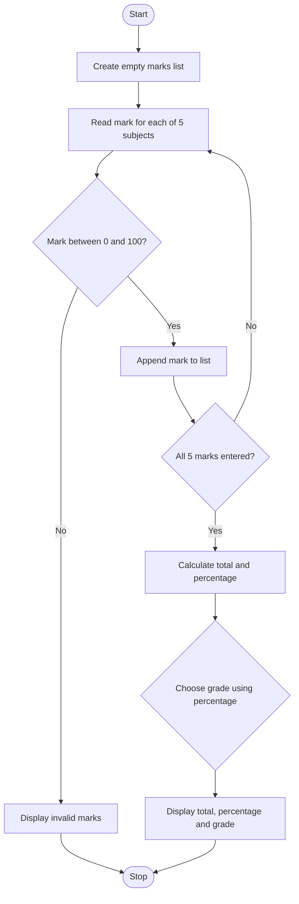

# Project 1: Student Marks and Grade Calculator

## 1. Problem Statement
Develop a Python program that accepts marks for five subjects, calculates the total and percentage, and assigns a grade based on the percentage.

## 2. Objectives
- Practise reading input and displaying output.
- Use type conversion to convert entered marks into numbers.
- Store values in a list.
- Calculate total and percentage using arithmetic operators.
- Use an `if-elif-else` ladder to determine the grade.

## 3. Syllabus Mapping
This project uses topics listed in the uploaded Python Programming Mid-1 syllabus:
- Variables and data types
- Input and output operations
- Type conversion
- Arithmetic operators and expressions
- `for` loop
- Lists
- `if-elif-else` decision-making

## 4. Assumptions
- The student has five subjects.
- Each subject is marked out of 100.
- All marks are entered as numbers between 0 and 100.
- Grade boundaries for this practice program are:
  - A: 90% and above
  - B: 80% to below 90%
  - C: 70% to below 80%
  - D: 60% to below 70%
  - E: 40% to below 60%
  - F: below 40%
- These grade boundaries are sample assumptions and should be changed if the faculty specifies different rules.

## 5. Algorithm
1. Start.
2. Create an empty list called `marks`.
3. Repeat for subjects 1 through 5:
   1. Read the subject mark.
   2. If the mark is below 0 or above 100, display an error and stop.
   3. Otherwise, append the mark to the list.
4. Calculate the total using `sum(marks)`.
5. Calculate the percentage by dividing the total by the number of subjects.
6. Use an `if-elif-else` ladder to select a grade.
7. Display total marks, percentage, and grade.
8. Stop.

## 6. Pseudocode
```text
START
    marks = empty list

    FOR subject from 1 to 5
        INPUT mark
        IF mark < 0 OR mark > 100
            DISPLAY "Invalid marks"
            STOP
        END IF
        APPEND mark to marks
    END FOR

    total = SUM(marks)
    percentage = total / LENGTH(marks)

    IF percentage >= 90
        grade = "A"
    ELSE IF percentage >= 80
        grade = "B"
    ELSE IF percentage >= 70
        grade = "C"
    ELSE IF percentage >= 60
        grade = "D"
    ELSE IF percentage >= 40
        grade = "E"
    ELSE
        grade = "F"
    END IF

    DISPLAY total, percentage, grade
STOP
```

## 7. Flowchart
Use the following Mermaid flowchart (GitHub can render Mermaid in Markdown):



## 8. Source Code
The complete runnable source is in [`main.py`](main.py).

## 9. Test Cases

| Test | Subject marks | Expected total | Expected percentage | Expected grade |
|---|---|---:|---:|---|
| 1 | 90, 92, 88, 95, 85 | 450 | 90.00% | A |
| 2 | 70, 75, 80, 65, 60 | 350 | 70.00% | C |
| 3 | 30, 35, 25, 40, 20 | 150 | 30.00% | F |
| 4 | 80, 80, 80, 80, 80 | 400 | 80.00% | B |
| 5 | 90, 85, -1, 70, 60 | Not calculated | Not calculated | Invalid marks message |

## 10. Sample Execution
Example input:
```text
Enter marks for subject 1 (0-100): 90
Enter marks for subject 2 (0-100): 92
Enter marks for subject 3 (0-100): 88
Enter marks for subject 4 (0-100): 95
Enter marks for subject 5 (0-100): 85
```

Expected output:
```text
----- Student Result -----
Total marks : 450.0 / 500
Percentage  : 90.00%
Grade       : A
```

Run the program yourself and capture a screenshot of the actual terminal output for your final submission.

## 11. Conclusion
The Student Marks and Grade Calculator demonstrates how Python input/output, type conversion, lists, loops, arithmetic operations, and conditional statements can be combined to solve a simple real-world problem.

## 12. How to Run
Open a terminal in this folder and run:
```bash
python main.py
```
If your system uses `python3`, run:
```bash
python3 main.py
```
